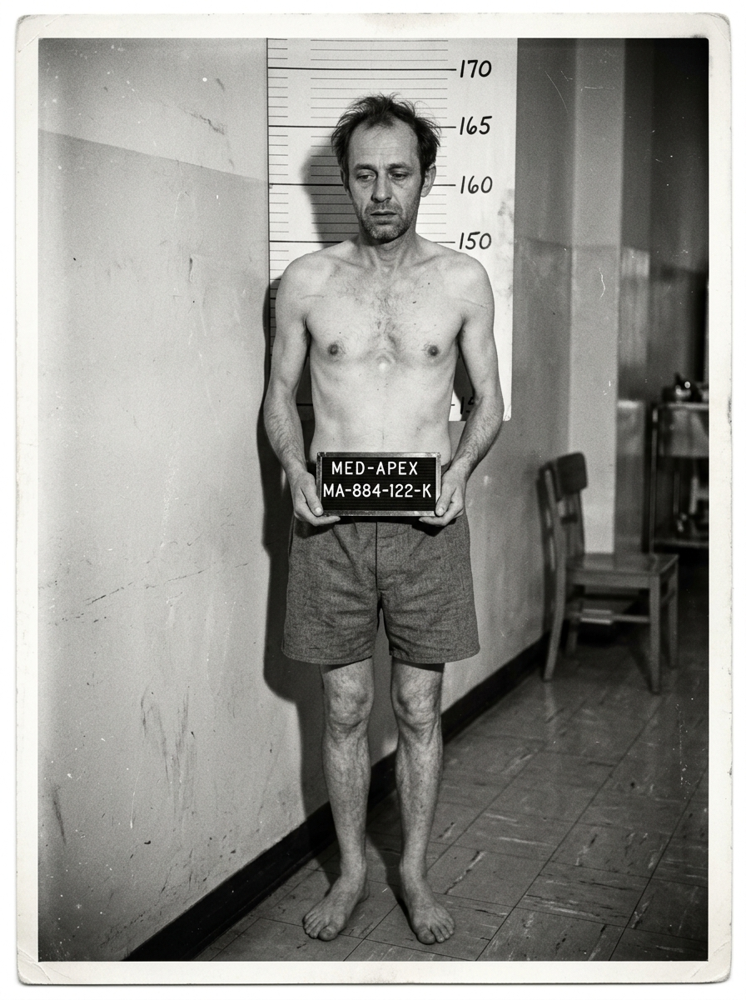
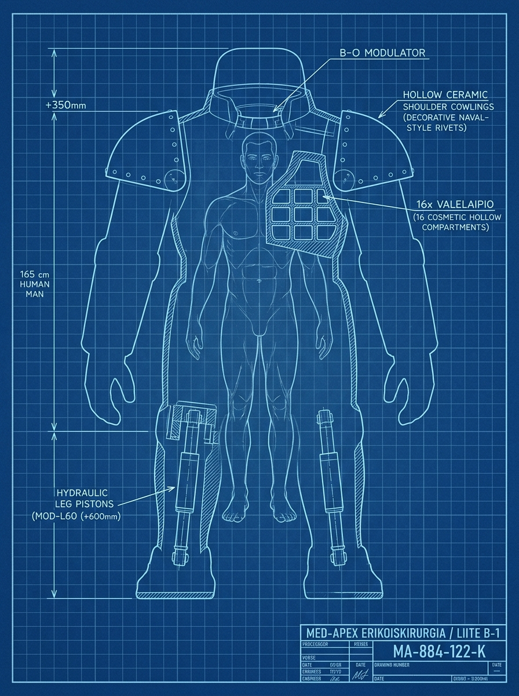

# Proppi 18: Arpijalostajan kompromaattikansio — Komentaja Uppoamaton Kolossi

> **PJ — ei tulosteta tätä laatikkoa.**  
> **Tekijä:** Matriarkka Arpijalostajan yksityiskanslia (Med-Apex Konserni, erikoiskansio MA-TK-09).  
> **Ääni:** Kuiva, kliinisen tarkka esteettisen kirurgian toimenpide- ja laskuerittely. Med-Apex ei saarnaa; se pitää kirjaa asiakkaidensa heikkouksista, esteettisistä valheista ja maksurästeistä vallankäytön välineenä.  
> **Jako:** Toimitettu Sahyen päätelaitteeseen salatulla datasirulla Hissikehä 03:n pikahissin noustessa ylimmälle kiekolle (sopimuksen n:o 902/MA velvoittamana kaupanpäällisenä).  
>  
> **Mitä tämä dokumentti on (Vain PJ:lle):**  
> Tämä asiakirja ei ole yleishyödyllinen pulmanratkaisuavain eikä se paljasta mitään aseman muista juonista, kuivatelakasta tai Kuorosta. Se on saatu Med-Apexin matriarkka Arpijalostajalta, ja **sen sisältö rajoittuu puhtaasti asioihin, jotka ovat klinikan omassa tiedossa**:  
> * **1. Gigantti = Kolossi (Kojima-mainen ilmiselvyys):** Nimi *Uppoamaton Kolossi* on suora viittaus Titanicin sisarlaivaan (*RMS Gigantic* / Gigantti = Kolossi) ja Titanicin hubrikseen. Haarniska itsessään on **KW:n (Kone & Voima) virallinen sotilas- ja telakka-alusta** (KW-RV Gigantti -laipiorunko). Med-Apexin esteettisen kirurgian potilaskortti paljastaa, että kolmemetrisen laivateräksisen rungon sisällä on 165 cm pitkä, huonoryhtinen entinen satamakirjuri, jolle klinikka on tehnyt laittomat luunpidennykset, keraamiset hartiatäytteet ja äänimodulaation sopeuttaakseen hänet KW-alustaan.  
> * **2. Klinikan valelaskut ja sotilasvarojen kuppaaminen:** Med-Apexin kirjanpito osoittaa Kolossin vaatineen klinikkaa laskuttamaan henkilökohtaiset kehonmuokkaus- ja kauneusleikkauksensa Ratasvartion operatiiviselta hankintatililtä väärennetyillä laipiorakenteiden ja KW-haarniskoiden huoltonimikkeillä (yhteensä 97 000 kr). Lisäksi Kolossilla on 48 500 kr maksamaton klinikkavelka, jota hän on kieltäytynyt maksamasta uhaten klinikkaa sotilaallisella tarkastuksella.  
> * **3. Pelaajien johtopäätös (Proppi 06 + Proppi 18):** Asiakirja ei sisällä armeijan sisäisiä muonatilastoja. Vasta kun pelaajat vertaavat Med-Apexin laskuja Laipion vartioraporttiin (Proppi 06), he tajuavat, miksi varuskunnan laipiorahat katosivat ja miksi alokkaiden ruoka leikattiin laihaksi proteiinipadaksi.  
>  
> **Miten tämä horjuttaa hänen asemaansa:**  
> KW-Konsortion gamistinen esikunta (*Lukuvarjo*, *Alirutiini*) ei siedä budjettipetoksia eikä henkilökohtaista turhamaisuutta sotilasresursseilla. Jos tämä laskuerittely ja klinikkakansio päätyvät konsortion auditoijille tai varuskunnan miehistölle, Kolossi menettää virkansa ja kasvonsa.  
>  
> **Miten Kolossi reagoi, jos se tuodaan esiin (Epärationaalinen pikkumaisuus):**  
> Jos pelaajat tuovat tämän kansion esiin tai vihjaavat sen sisältöön, Kolossi ei reagoi kylmän taktisesti. Paljastus osuu suoraan hänen hauraimpaan kohtaan: hänen omaan häpeäänsä ja miehuuteensa.  
> **Kolossi alkaa toimia raivokkaan ja naurettavan pikkumaisesti:**  
> * Hän alkaa inttää kovaäänisesti esteettisistä yksityiskohdista (*"Tämä runko on Alasimen aito Gigantti-luokan laivaprofiili! Minulla on luonnostaan raskaat luut! Tässä ei ole mitään toppauksia, nämä ovat vesitiiviitä osastoja! Kuitissa on laskuvirhe!"*).  
> * Hän loukkaantuu henkilökohtaisesti ja alkaa rankaista kaikkia ympärillään: määrää lähimmän vartijan arestiin väärästä ilmeestä, komentaa musiikin ja tarjoilun heti poikki, kieltää ketään poistumasta huoneesta ja määrää koko sektorin ovet pneumaattiseen lukkoon vain estääkseen paperin leviämisen.  
> * Tämä pikkumainen ylireaktio laukaisee varuskunnan hätäsulun (*lockdown*), mikä sulkee ovet ja syöksee tilanteen hallitsemattomaan kineettiseen kaaokseen.  
> 
---

```
╔══════════════════════════════════════════════════════════════════════╗
║                    MED-APEX KONSERNI · YKSITYISARKISTO               ║
║        ESTEETTIS-REKONSTRUKTIIVISEN OSASTON ASIAKASKANSIO MA-TK-09    ║
║          Luokitus: SILMÄTERÄ · Vain Matriarkan henkilökohtaiseen     ║
║                    käyttöön ja strategiseen painostukseen            ║
╚══════════════════════════════════════════════════════════════════════╝
```

**ASIAKAS:** Komentaja Uppoamaton Kolossi  
**SOTILASREKISTERI:** KW-RV-012 (Ratasvartion kenttäkomento, Lohko Nolla)  
**MED-APEX ASIAKASTUNNUS:** MA-884-122-K  
**ARKISTOVIITE:** Dynastia-arkisto VII · Aikakausinide XIV (Folio 312)  
**SÄÄTYLUOKITUS REKISTERISSÄ:** Luokka IV (Plebeijiasiakas / Ulkopuolinen nousukas, ei vahvistettua sukulinjaa Kruunulehdossa)  
**STATUS KIRJANPIDOSSA:** Avoin saatava / Saatavienvalvonnan erikoisseuranta  
**ALKUPERÄINEN BIOLOGINEN REKISTERI (Ennen toimenpiteitä):** Pituus 165 cm, paino 64 kg, lievä rintalastan kuoppaisuus (pectus excavatum), luhistunut ryhti.  
**KOHDEHAARNISKA:** KW:n virallinen rynnäkkö- ja laipioeksorunko (Malli KW-RV Gigantti-01, Alasimen telakka)  
**TOIMENPIDETILAUS:** "Biologis-kirurginen sovitus ja esteettinen runkolavastus KW-alustaan"  

---

### 1. TOIMENPIDETIEDOT: BIOLOGINEN SOVITUS KW:N GIGANTTI-RUNKOON
*(Tilausviite: "Uppoamaton raskasrunko / Alasimen sisaraluksen profiili")*

Kohteen kolmemetrinen laivateräksinen ulkomuoto perustuu KW:n raskaaseen sotilas- ja teollisuusrunkoon (KW-RV Gigantti), jonka sisään hento biologinen potilas on sovitettu Med-Apexin esteettisen kirurgian osastolla suoritetuilla laajoilla luu- ja kudosmuokkauksilla:

* **Alaraajojen kirurgiset ankkurit ja jatkemoduulit L-60 (+60 cm):**  
  Reisiluuhun pultatut titaaniset ankkurointikiskot ja mekaaniset korotusmoduulit KW-haarniskan poljinkammioon. Potilaan omat jalkaterät päättyvät haarniskan polvikammioon; jatkeilla saavutettu asiakkaan tilaama 3 050 mm seisomakorkeus. Jatkuvia pehmytkudosrepeämiä potilaan kieltäydyttyä vuodelevosta.
* **Keraamiset hartiatäytteet ja esteettiset valelaipiot (+35 cm):**  
  Solisluun päälle ankkuroidut keraamiset muotokaaret ja keinotekoiset hartiatäytteet. Rintakehän ja KW-ulkokuoren välinen tyhjä tila peitetty kuudellatoista silikoniteräksisellä valelaipiolla asiakkaan vaatiman "vesitiiviin laivaprofiilin" aikaansaamiseksi. Täytteet lisäävät potilaan selkärangan kuormitusta ilman biologista lihastukea.
* **Kraniaalinen äänenmadallin (Malli B-0 "Sumusireeni"):**  
  Kurkunpään magneettinen resonanssipanta. Asiakkaan luonnollinen kimeä tenoriääni muunnettu keinotekoisesti KW:n kenttäkomennon metallisen räsähtäväksi 65 Hz laivastobassoksi.

```
────────────────────────────────────────────────────────────────────────
 MED-APEX ERIKOISKIRURGIA: ASIAKAS 884-122-K (SOVITUS KW-RUNKOON)
────────────────────────────────────────────────────────────────────────
 [x] KW-RV Gigantti -integraatio (L-60 luujatkeet) ... Asennettu (Öljyttävä)
 [x] KW-haarniskan sisäiset esteettiset valelaipiot ... Asennettu
 [x] Sumusireenin komento-oktaavit ................ Kalibroitu -24 dB tasolle
 Huomautus: Asiakas kieltäytynyt katsomasta alkuperäisiä profiilikuvia (liite B-1).
 Vaatii henkilökunnalta ehdotonta puhuttelumuotoa "Komentaja Uppoamaton Kolossi".
────────────────────────────────────────────────────────────────────────
```

---

### 2. MED-APEXIN LASKUTUS JA ASIAKKAAN VAATIMAT VALENIMIKKEET

Asiakas on maksattanut biologiset venytysleikkauksensa, toppauksensa ja jatkuvat huoltorasvauksensa vaatimalla Med-Apexin laskutusosastoa osoittamaan laskut suoraan Ratasvartion operatiiviselle tilille (`KW-RV-LOHKO-00`) teollisuusvalenimikkeillä:

* **Laskukopio MA-L-8812 (Summa 42 000 kr — Maksettu tililtä KW-RV-LOHKO-00):**  
  Asiakkaan vaatima laskutusnimike: *"Lohko Nollan KW-haarniskoiden keraaminen korroosiovahvistus"*.  
  Todellinen toimenpide klinikan leikkauspöytäkirjassa: Asiakkaan selän ja hartioiden esteettiset keraamiset täytesiivekkeet KW-haarniskan tyhjän tilan täyttämiseksi.
* **Laskukopio MA-L-9014 (Summa 55 000 kr — Maksettu tililtä KW-RV-LOHKO-00):**  
  Asiakkaan vaatima laskutusnimike: *"KW-RV pneumaattisten laipioiden raskaat teollisuusvaraosat ja nesteliittimet"*.  
  Todellinen toimenpide klinikan leikkauspöytäkirjassa: Reisiluun hydrauliset pituuskasvatusjatkeet ja nivelkorotukset KW-haarniskan ohjauspolkimiin.
* **Klinikan taloushuomautus (Pääkirjanpitäjä):**  
  Asiakas on kieltäytynyt henkilökohtaisesta maksusta ja pakottanut kirjaamaan leikkauskulut KW:n varuskunnan kalustonhuoltomäärärahoihin. KW-esikunnan kirjanpidossa toimenpiteet näyttävät KW:n oman sotilaskaluston peruskorjaukselta.

---

### 3. AVOIN SAATAVA JA ASIAKKAAN LAITON PAINOSTUS

Asiakkaalla on edelleen maksamatta Med-Apexille viimeisimmän hartioiden lisälevityksen loppuerä:

```
────────────────────────────────────────────────────────────────────────
 SAATAVAN ERITTELY: ASIAKAS 884-122-K
────────────────────────────────────────────────────────────────────────
 Gigantti-hartialinjan 3. vaiheen keraaminen viimeistely  35 000,00 kr
 Sumusireenimodulaattorin B-0 taajuushuolto ............   8 500,00 kr
 Erityisvoide (Arvenpeitto / Kliininen) ................   5 000,00 kr
────────────────────────────────────────────────────────────────────────
 AVOIN VELKASALDO ......................................  48 500,00 kr
────────────────────────────────────────────────────────────────────────
```

* **Perintämerkintä (Med-Apex Saatavienvalvonta):**  
  Kun perintäosasto lähestyi asiakasta rotaatiossa 40 avoimesta saldosta, asiakas kieltäytyi maksusta ja uhkasi asettaa klinikan varastot Ratasvartion aseelliseen sulkutarkastukseen saatavan virallisen perinnän estämiseksi.

* **Lakiasiainosaston käsittelymerkintä (Holvi 06):**  
  Saatavan ulosotto ja virallisen ilmoituksen jättäminen KW-Konsortion keskushallinnolle keskeytetty toistaiseksi Matriarkan suoralla määräyksellä. Asiakirja MA-TK-09 (sisältäen toimenpidevalokuvat ennen/jälkeen sekä valelaskutositteet) säilytetään matriarkan henkilökohtaisessa arkistossa. Luovutus vain suoralla valtuutuksella.

---

```
                                    Dynastia ARPIJALOSTAJA
                                    Yksityiskanslia, Lohko 06

                                    ARPIJALOSTAJA
                                    Matriarkka, Med-Apex Konserni

 [ LEIMA: MED-APEX YKSITYISARKISTO ]
 [ ASIAKIRJA LUOVUTETTU: LAKI-ASEMAN VIRALLISELLE AUDITOINNILLE ]
```

---

### LIITE A-1: ALKUPERÄINEN BIOLOGINEN VALOKUVA JA ANTROPOMETRINEN MITTAUS



**TALLENNE:** MA-FOTO-884-A1 · VEDOS 01  
**VALOTUS:** Rotaatio 04, Työvuoro B-3 (Klinikka 06)  
**KOHDE:** Asiakas MA-884-122-K (ennen esteettis-kirurgisia toimenpiteitä)  
**ENTINEN TOIMI:** Satamakirjuri / Telakan kirjanpitoapulainen  
**SÄÄTYLUOKITUS:** Luokka IV (Plebeijiasiakas, ei vahvistettua sukulinjaa Kruunulehdossa)  
**KOHDERUNKO:** Sovitus KW:n 3-metriseen Gigantti-sotilashaarniskaan  
**ARKISTOSIJAINTI:** Salainen Holvi 06 (Matriarkan määräys)  

| Antropometrinen parametri | Mitattu arvo |
| :--- | :--- |
| Luonnollinen seisomakorkeus | 165 cm (ilman korotuskenkiä) |
| Kokonaispaino | 64,2 kg |
| Rinnanympärys (lepo) | 82 cm |
| Rintalastan tila | Pectus excavatum (synnynnäinen kuopparinta) |
| Ryhti ja lihastonus | Luhistunut, voimakas etukeno |
| Luontainen ääniala | Korkea tenori (perustaajuus 185 Hz) |

```
────────────────────────────────────────────────────────────────────────
 KLIININEN HAVAINTO (MITTAUSOSASTO)
────────────────────────────────────────────────────────────────────────
 Kohteella on synnynnäinen rintalastan kuoppaisuus ja heikko luusto.
 Ei merkkejä geneettisestä säätyjalostuksesta tai sotilaskoulutuksesta.
 Asiakas vaatinut toistuvasti mittanauhan nollauspisteen uudelleentarkastusta.
────────────────────────────────────────────────────────────────────────
 [ LEIMA: ALKUPERÄISTALLENNE · EI ASIAKKAAN NÄHTÄVÄKSI ]
────────────────────────────────────────────────────────────────────────
```

* **Kliininen muistio (MA-TK-09 / Liite A-1):**  
  Asiakas vaatinut tämän negatiivin ja vedoksen välitöntä tuhoamista esteettisen kirurgiasopimuksen 884-K pykälän 4 nojalla. Arkistoitu Matriarkan suoralla määräyksellä salaiseen Holviin 06 vastaisen varalle. Asiakas kieltäytynyt katsomasta omaa profiilivedostaan.

---

### LIITE B-1: BIOLOGIS-MEKAANINEN INTEGRAATIOLUONNOS (KW-HAARNISKAN SOVITUS)



**PIIRUSTUSVIITE:** MA-DWG-884-GIGANTTI (Rev 3)  
**SKAALA:** 1:25 · Biologis-mekaaninen poikkileikkaus  
**LAATIJA:** Med-Apex Kirurgia & KW-RV Telakkasovitus  
**HAARNISKA-ALUSTA:** KW-RV Gigantti-01 (Kone & Voima / Alasimen telakka)  
**INTEGRAATIO:** Asiakas MA-884-122-K sijoitettuna KW-kuoren sisään  
**KOKONAISKORKEUS:** 3 050 mm (KW-haarniskan komentosillan seisomakorkeus)  
**MED-APEXIN OSUUS:** Luujatkeet, onttojen tilojen täytteet ja ohjausliitännät  

| Moduuli | Tekniset speksit | Med-Apexin todellinen kirurginen sovitus |
| :--- | :--- | :--- |
| **MOD-L60** | +600 mm luujatke | Reisiluun titaaniankkurit ja mekaaniset korotusmoduulit |
| **HARTIAKAARI** | +350 mm / puoli | Keraamiset muotokaaret ja solisluukiinnikkeet |
| **VALELAIPIOT** | 16 onteloa | Silikoniteräksiset ontelotäytteet (kosmeettinen laivamuotoilu) |
| **B-0 MODULAATTORI** | Resonanssipanta | Kurkunpään magneetti-implantti (65 Hz komentoääni) |

```
────────────────────────────────────────────────────────────────────────
 YLILÄÄKÄRIN SEURANTAHUOMAUTUS: LUUSTOKUORMITUS JA LÄÄKERIIPPUVUUS
────────────────────────────────────────────────────────────────────────
 Potilas kieltäytynyt määrätystä fysioterapiasta ja leikkauksen
 jälkeisestä vuodelevosta vedoten varuskunnan paraatikatselmuksiin.
 Reisiluun titaaniliitoksissa todettu toistuvia mikromurtumia ja
 kroonista luukalvotulehdusta. Potilas anastanut klinikalta
 luvattomasti vahvoja hermopuudutteita ja vaatinut henkilökuntaa
 salaamaan kipuoireensa sotilasjohdolta.
────────────────────────────────────────────────────────────────────────
 [ LEIMA: KLIININEN SEURANTA · SALAINEN · HOLVI 06 ]
────────────────────────────────────────────────────────────────────────
```

* **Med-Apexin sovituspöytäkirja (KW-Gigantti / Potilas 884-122-K):**  
  Asiakkaan vaatima "uppoamattoman komentajan" olemus toteutettu kytkemällä 165 cm biologinen keho KW:n viralliseen sotilashaarniskaan. Kaikki kirurgiset ja esteettiset sovitustyöt laskutettu Ratasvartion määrärahoista valekirjauksilla (KW-laipiovaraosat MA-L-8812 ja MA-L-9014). Alkuperäinen sovitusluonnos arkistoitu MA-TK-09 asiakaskansioon.
